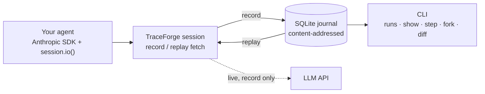

<div align="center">

# TraceForge

**Replay. Debug. Reimagine.**

Deterministic record/replay debugging for LLM agents.

[](#-testing)
[](https://nodejs.org)
[](./tsconfig.json)
[](./LICENSE)

[**Live Demo**](https://traceforgeai.vercel.app/) &nbsp;·&nbsp; [**GitHub**](https://github.com/Vijaypn87/TraceForge) &nbsp;·&nbsp; [**Quick start**](#-quick-start)

</div>

## ◆ Tech stack


---

## ◆ About

Your agent crashed on step 47 of 50. Reproducing it normally means re-running 46 steps, paying for every token, and hoping the model takes the same path.

TraceForge records an agent run once, then replays it **byte-exact, offline, with no API key**. Fork any step to see what *would* have happened, and diff the two timelines. It targets the Anthropic SDK and anything you wrap with `session.io()`.

## ◆ Key features

| ▶ **Deterministic replay** | ⑂ **Counterfactual forking** | ≠ **Execution diff** |
| :-- | :-- | :-- |
| Responses are served from a local SQLite journal instead of the network. Strict mode treats a journal miss as an error. | Rewrite a recorded response with `--text`, `--response` or `--response-file`, then replay the alternate run. | Compare two runs event by event; reports the first divergence and whether the request or only the response changed. |

| ≋ **SSE chunk fidelity** | ⇄ **Concurrency-safe** | ∞ **Hybrid replay** |
| :-- | :-- | :-- |
| Streamed responses are recorded and replayed with their exact chunk boundaries, including mid-stream aborts. | Racing identical requests are paired by recorded arrival order, so each caller gets its own response. | `--policy hybrid` serves history, goes live after the divergence, and journals into a new run that replays offline. |

> **Determinism guarantee:** replay is deterministic at the SDK I/O boundary. If your agent's only non-determinism flows through the wrapped client and `session.io()`, recorded values replay byte-exact. OS-level and instruction-level non-determinism are out of scope.

## ◆ How it works



- **Transport-boundary interception:** you pass `session.fetch` to the SDK client. No proxy, no certificate tricks, no global patching.
- **SQLite journal:** every LLM call and `io()` result is an event; request and response bodies are stored as SHA-256 content-addressed blobs (`better-sqlite3`, WAL mode). Credentials are redacted before anything reaches disk: request auth headers and cookies, secret response headers (`set-cookie`, `anthropic-organization-id`), and credential-like URL query parameters (`key`, `api_key`, `token`, `signature`, …).
- **Request canonicalization and fingerprinting:** JSON bodies are key-sorted, header names are case-folded, and volatile headers (`authorization`, `x-api-key`, `x-request-id`, `x-stainless-*`, …) are dropped before SHA-256 hashing. Semantic headers like `anthropic-version` stay in the fingerprint.
- **Concurrency:** record stores each request's arrival index; replay pairs by it, so concurrent callers keep their own responses.
- **Fork and compare:** a fork copies history before step N, swaps in the edited response, and drops the unknowable future. `diff` reports each event as same, changed, only-in-a or only-in-b.

Design rationale: [DECISIONS.md](./DECISIONS.md).

## ◆ Quick start

> **Status:** early (v0.0.1) and not yet published to npm, so install from source. Works on macOS, Linux and Windows (Node ≥ 20).

```bash
git clone https://github.com/Vijaypn87/TraceForge.git
cd TraceForge
npm install
npm run build
npm link            # makes the `traceforge` command available
```

Wire your agent (two lines):

```ts
import Anthropic from "@anthropic-ai/sdk";
import { fromEnv } from "traceforge";

const session = fromEnv();
const client = new Anthropic({
  // The SDK refuses to send a request without a key. Replay never reaches the
  // network, so any placeholder works offline; record mode uses your real key.
  apiKey: process.env.ANTHROPIC_API_KEY ?? "offline-replay",
  fetch: session.fetch,
});
// wrap tools and other non-determinism: await session.io("fx_rate", fetchRate)
// call session.finish() when the run is done
```

Then drive it from the CLI:

```bash
traceforge record -- node agent.js          # run live, journal everything
traceforge runs                             # list recorded runs
traceforge show <run>                       # event timeline
traceforge step <run>                       # walk the timeline interactively
traceforge replay <run> -- node agent.js    # re-run offline
traceforge fork <run> --at 4 --text '…'     # rewrite step 4
traceforge diff <run> <fork>                # first divergence
```

To `import … from "traceforge"` in another project, run `npm link traceforge` there. Options go before the run id; everything after `--` is passed to your command.

## ◆ Demo

Live site: **[traceforgeai.vercel.app](https://traceforgeai.vercel.app/)**. It has an interactive record → replay → fork → diff walkthrough (the session shown there is illustrative).

The repo also ships a runnable expense-audit agent, [`demo/agent.ts`](./demo/agent.ts), with a bug that only appears at the last step. Record it once with `ANTHROPIC_API_KEY` set; reproducing, forking and diffing are then offline:

```console
$ traceforge record -- npx tsx demo/agent.ts              # crashes at the final step
$ traceforge replay <run> -- npx tsx demo/agent.ts        # same crash, offline, $0
$ traceforge fork <run> --at 4 --text '{"total_usd": 0}'  # what if the model said $0?
$ traceforge diff <run> <fork>                            # first divergence at seq 4
```

## ◆ Known limitations

- **Transport errors are not journaled.** If the live `fetch` itself throws (DNS failure, connection reset), no event is recorded, so a replay of that run reports a miss instead of reproducing the error. HTTP error *responses* (4xx/5xx) are recorded and replay normally.
- **Unfinished streams may be lost.** A streamed response is journaled when it ends, errors, or is cancelled. If the agent abandons a stream without cancelling it, or calls `session.finish()` before it settles, that event is not recorded.
- **`io()` matches by name and call order, not arguments.** Replay returns the recorded result for the *n*-th `io("name")` call even if its inputs changed. Errors replay as plain `Error` objects with the original `name` and `message`, so `instanceof` checks on custom error classes do not hold.
- **Multipart uploads do not replay.** `FormData` bodies carry a random boundary, so their fingerprint changes every run.
- **Body redaction is not automatic.** Secrets you put in request or response *bodies* (e.g. inside a prompt) are journaled as-is.

## ◆ Testing

```bash
npm test            # 75 tests across 12 files
npm run typecheck
```

Coverage includes request canonicalization, the journal, record and replay, SSE streaming (including truncation and the real Anthropic SDK consuming a replayed stream), concurrent replay races, fork and hybrid replay, diff, and the CLI.

## ◆ License

[MIT](./LICENSE) © Vijay PN
