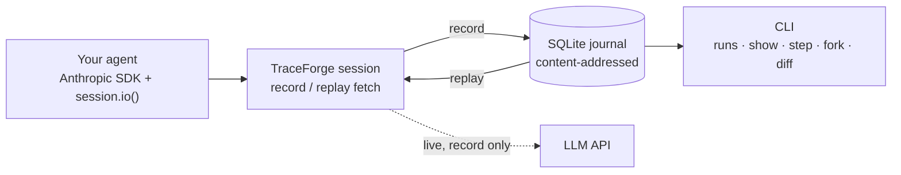

<div align="center">

# TraceForge

**Replay. Debug. Reimagine.**

Deterministic record/replay debugging for LLM agents.

[](./LICENSE)
[](#-testing)
[](https://nodejs.org)
[](./tsconfig.json)

**Live Demo:** _coming soon_ &nbsp;·&nbsp; [**GitHub**](https://github.com/Vijaypn87/TraceForge) &nbsp;·&nbsp; [**Quick start**](#-quick-start)

</div>

---

## ◆ About

Your agent crashed on step 47 of 50. Reproducing it normally means re-running 46 steps, paying for every token, and hoping the model takes the same path.

TraceForge records an agent run once, then replays it **byte-exact, offline, with no API key**. Fork any step to see what *would* have happened, and diff the two timelines.

## ◆ Workflow

```console
$ traceforge record -- npx tsx demo/agent.ts              # RECORD  run live, journal everything
✗ TypeError: Cannot read properties of undefined          #         crash at the last step

$ traceforge replay <run> -- npx tsx demo/agent.ts        # REPLAY  same crash, offline, $0

$ traceforge fork <run> --at 4 --text '{"total_usd": 0}'  # FORK    rewrite step 4's response
$ traceforge replay <fork> -- npx tsx demo/agent.ts       #         the agent lives the edited history

$ traceforge diff <run> <fork>                            # DIFF    where the futures diverge
first divergence at seq 4
```

## ◆ Key features

| ▶ **Deterministic replay** | ⑂ **Counterfactual forking** | ≠ **Execution diff** |
| :-- | :-- | :-- |
| Responses are served from a local SQLite journal, with exact SSE chunk boundaries. No network, no tokens. | Rewrite any recorded response with `--text`, `--response` or `--response-file`, then replay the alternate run. | Compare two runs event by event and jump to the first divergence. |

| ∞ **Closed under replay** | ⇄ **Concurrency-safe** | # **Canonical fingerprints** |
| :-- | :-- | :-- |
| `--policy hybrid` serves history, goes live after the edit, and re-journals into a new run that replays offline. | Identical racing requests are paired by recorded arrival order, so each caller gets its own response. | Requests are canonicalized and volatile headers stripped, so a miss fails loudly instead of returning a wrong hit. |

> **Determinism guarantee:** replay is deterministic at the SDK I/O boundary. If your agent's only non-determinism flows through the wrapped client and `session.io()`, recorded values replay byte-exact. OS-level and instruction-level non-determinism are out of scope.

## ◆ Architecture



TraceForge injects a `fetch` at the SDK transport boundary: no proxy, no certificate tricks, no global patching. The reasoning behind each design choice is in [DECISIONS.md](./DECISIONS.md).

## ◆ Tech stack


## ◆ Quick start

```bash
git clone https://github.com/Vijaypn87/TraceForge.git
cd TraceForge
npm install
npm run build
npm link            # makes the `traceforge` command available
```

Wire your agent (two lines), then drive it from the CLI:

```ts
import Anthropic from "@anthropic-ai/sdk";
import { fromEnv } from "traceforge";

const session = fromEnv();
const client = new Anthropic({ fetch: session.fetch });
// wrap tools and other non-determinism: await session.io("fx_rate", fetchRate)
```

```bash
traceforge record -- node agent.js          # run live, journal everything
traceforge runs                             # list recorded runs
traceforge show <run>                       # event timeline
traceforge replay <run> -- node agent.js    # re-run offline
traceforge fork <run> --at 4 --text '…'     # rewrite step 4
traceforge diff <run> <fork>                # first divergence
```

To `import … from "traceforge"` in another project, run `npm link traceforge` there. Options go before the run id; everything after `--` is passed to your command. The bundled expense-audit demo ([`demo/agent.ts`](./demo/agent.ts)) needs `ANTHROPIC_API_KEY` for the first recording only; everything after that is offline.

## ◆ Testing

```bash
npm test            # 69 tests across 12 files, including real-SDK streaming and concurrency races
npm run typecheck
```

## ◆ License & acknowledgements

Released under the [MIT License](./LICENSE).

TraceForge is adapted from [**Rewind**](https://github.com/mihhhir08/rewind) by **Mihir Sinh Chavda**, which provides the original record/replay engine. The original MIT license and copyright notice are preserved in [LICENSE](./LICENSE).
